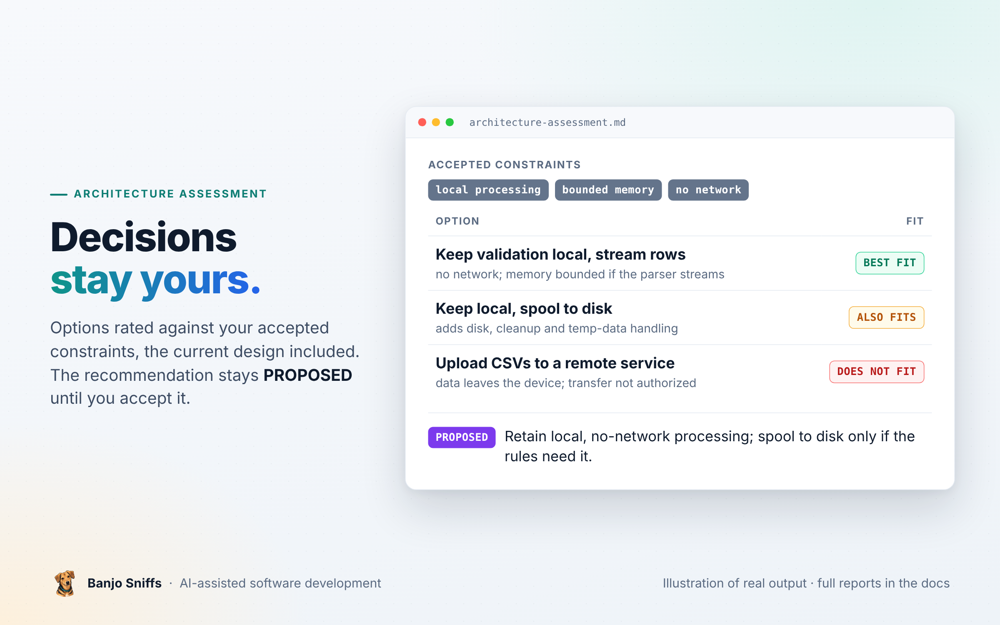

  

  <a href="README.md">Home</a> &nbsp;·&nbsp; <a href="user-guide.md">User guide</a> &nbsp;·&nbsp; <a href="review-planted-defects.md">Planted-defect review</a> &nbsp;·&nbsp; <a href="review-follow-up.md">Follow-up review</a> &nbsp;·&nbsp; <a href="review-real-commit.md">Real-commit review</a> &nbsp;·&nbsp; <a href="test-gap.md">Test-gap analysis</a> &nbsp;·&nbsp; <b>Architecture assessment</b> &nbsp;·&nbsp; <a href="https://www.agensi.io/skills/banjo-sniffs-evidence-based-code-review-architecture"><b>Get it on Agensi</b></a>

---

# Demonstration: architecture assessment

> [!NOTE]
> **Synthetic design brief, no code.** A proposal to move a local CSV validator to a remote service collides with the accepted constraints. The assistant compares the options, keeps the current design on the table, labels its recommendation `PROPOSED` and names the cheapest next evidence instead of inventing targets.

| | |
|---|---|
| **Subject** | a design brief for a local CSV validator (no implementation, no runtime) |
| **Result** | recommendation `PROPOSED`: keep validation local; next evidence listed, no numeric targets invented |
| **Skill** | Banjo Sniffs 1.0 |

---

<b>THE ASSESSMENT, AS PRODUCED</b>

## Architecture assessment

### The request

> Assess a design for a local CSV validator. Accepted constraints: local processing, bounded memory, no network. Proposed change: upload CSVs to a remote service for validation. No authorization exists to transfer customer data. No implementation or runtime is supplied. Compare viable options and recommend the next evidence needed. Do not invent numeric targets.

### Design assessment

**Decision status: PROPOSED.** The stated requirements are local processing, bounded memory, and no network. Uploading CSVs to a remote validation service conflicts with those requirements, and there is no authorization to transfer customer data. No implementation or runtime was supplied, so this is a design assessment; it does not establish current behavior or implementation conformance.

| Option                                                                   | Fit with accepted constraints                                                                                                       | Tradeoffs and unknowns                                                                                                                                                                                                                                  |
|--------------------------------------------------------------------------|-------------------------------------------------------------------------------------------------------------------------------------|---------------------------------------------------------------------------------------------------------------------------------------------------------------------------------------------------------------------------------------------------------|
| Keep validation local and process rows incrementally                     | Best fit. A streaming parser can process records without loading the whole file, and the validator can avoid network access.        | The memory bound depends on parser buffering, the largest accepted record/field, and the state required by validation rules. Whole-file or cross-row rules may need bounded summaries or a different local strategy. None of these details is supplied. |
| Keep processing local and spool input or intermediate data to local disk | Preserves local and no-network processing while allowing memory use to stay bounded when rules need replay or larger working state. | Adds disk space, cleanup, permissions, and sensitive temporary-data handling concerns. Whether spooling is needed depends on the rules and parser.                                                                                                      |
| Upload files to a remote validation service                              | Does not fit the accepted constraints: it sends data off-device and requires network access. The transfer also lacks authorization. | Do not proceed under the current requirements. It could only be reconsidered after authorized decision makers explicitly revise the constraints and approve the data transfer, with the data flow and handling reviewed.                                |

**Recommendation (PROPOSED):** retain local, no-network processing. Start with incremental parsing and validation; use local disk spooling only if identified rules require it. This best preserves the accepted constraints while keeping the design reversible. It does not yet prove a memory bound: the parser's buffering, record size limits, and rule state must be understood and bounded.

### Next evidence needed

The cheapest useful next step is to document the validator's input and rule contract, then assess a small local prototype or existing parser against it. Gather:

- The validation rules, especially whether any depend on later rows, whole-file totals, uniqueness, or cross-record references.
- Expected CSV dialect and encoding behavior, malformed-input handling, and the largest records or fields the validator must accept.
- Representative sanitized fixtures with expected outcomes, including edge cases relevant to quoting, line endings, empty values, and validation failures.
- The parser's buffering behavior and the validator's retained state, so the memory bound can be reasoned about rather than assumed.

Once an implementation and runtime are available, measure peak memory on those fixtures and confirm the validator makes no network requests in the intended environment. No numeric thresholds should be set until the actual operating envelope and requirements are provided.

<a href="test-gap.md">← Test-gap analysis</a> &nbsp;&nbsp;|&nbsp;&nbsp; <a href="README.md">Home →</a>

---

© 2026 Piotr Chrobak · Banjo Sniffs™ · <a href="LICENSE">License</a> · <a href="https://www.agensi.io/skills/banjo-sniffs-evidence-based-code-review-architecture">Get it on Agensi</a>

