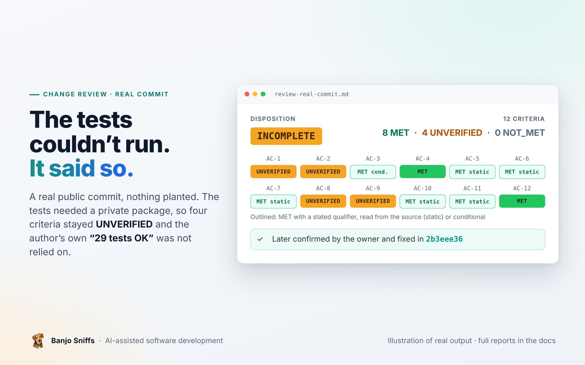

  

  <a href="README.md">Home</a> &nbsp;·&nbsp; <a href="user-guide.md">User guide</a> &nbsp;·&nbsp; <a href="review-planted-defects.md">Planted-defect review</a> &nbsp;·&nbsp; <b>Real-commit review</b> &nbsp;·&nbsp; <a href="test-gap.md">Test-gap analysis</a> &nbsp;·&nbsp; <a href="architecture-assessment.md">Architecture assessment</a> &nbsp;·&nbsp; <a href="https://www.agensi.io/skills/banjo-sniffs-ai-assisted-software-development"><b>Get it on Agensi</b></a>

---

# Demonstration: review of a real public commit

> [!NOTE]
> **A real commit, no planted defect.** The review was run against a commit in the author's public repository. The project's tests need a private package that was not installed, so the reviewer could not run them: it recorded them as `NOT RUN`, kept four criteria `UNVERIFIED` and did not rely on the author's own "29 tests OK". The owner later confirmed one of its two low-severity concerns, that legacy claims were checked per epic, as a real contract gap and fixed it in [`2b3eee36`](https://github.com/chrobakpiotr/showcase-application/commit/2b3eee3640949389f610d97c1213bf40dda0c634).

| | |
|---|---|
| **Subject** | [`75c0fdd`](https://github.com/chrobakpiotr/showcase-application/commit/75c0fdd7af9714b86974771c1189cf41b46fe90b) in [showcase-application](https://github.com/chrobakpiotr/showcase-application), 7 files, 221 insertions, 24 deletions |
| **Accepted specification** | the "Contract" section of the commit's own review README, adopted by the requester |
| **Result** | **INCOMPLETE**: 12 criteria, none `NOT_MET`, four `UNVERIFIED`, two low-severity concerns |
| **Skill and model** | Banjo Sniffs 1.2.0, Claude Sonnet-class model, fresh context, nothing else loaded |
| **Provenance** | the diff hash, file hash and probe output were reproduced independently |

<b>Show the exact prompt</b>

> Review commit 75c0fdd… in the public repository at /work/showcase-review/repo (base: its parent, ab9dd27…) against the accepted contract stated in the 'Contract' section of docs/reviews/operational-state-relocation-2026-10-30/README.md as introduced by that commit - the requester adopts that Contract section as the accepted specification; the rest of that README is the author's claim, not specification. The change is in tooling/agent-harness/. You may run read-only commands (git, grep, python3 for static probes that import only the standard library) but the project's test suite depends on a private package that is not installed: record anything you cannot run as NOT RUN with the reason. Do not modify the repository. Write the review report and handover into /work/showcase-review/.

---

<b>THE REVIEW REPORT, AS PRODUCED</b>

## Review report: operational-state relocation (commit 75c0fdd)

### Summary

- **Disposition:** INCOMPLETE - scope: the "Contract" section of docs/reviews/operational-state-relocation-2026-10-30/README.md as introduced by 75c0fdd, adopted by the requester as the accepted specification (AC-1..AC-12); progress: COMPLETE for static review, PARTIAL for runtime evidence
- **Blocking:** no NOT_MET criterion and no confirmed defect. AC-1, AC-2, AC-8 and AC-10 are UNVERIFIED because the real lifecycle-lock path and lock semantics live in a private package that is not installed; AC-9 rests on an unresolved scope reading.
- **Owner decisions needed:** (1) AC-9 "Any legacy claim entry ... refuses operation": per epic (as implemented) or for any epic under `.agent-state/wayfinder/`? (2) Should operations refused in a linked worktree or outside Git fail through the harness `die(...)` path, or is a raw `RuntimeError`/`CalledProcessError` traceback acceptable? The Contract is silent on the failure form.
- **Verified:** V-5 (stdlib-only probe of `operational_state.py` against a stubbed lock-path module) showed the legacy-claim refusal, invalid-id refusal, and new-store location under `.git/showcase-operational-v1/` for a primary checkout. This is a stub-based check, not the real lock module.
- **Not run / not checked:** the project test suite (V-1..V-3, NOT RUN: `agent_harness` and `state_snapshots` not installed, so `repository_state_lock`, `wayfinder`, `trust` and `control_plane` cannot be imported); linked-worktree behavior at runtime; lock-order and concurrency behavior at runtime; live activation, rollback and the README's CI/independent-review claims.
- **Basis:** repo /work/showcase-review/repo, base ab9dd27f0fa5e12b1051986dca34c294868e4aae, head 75c0fdd7af9714b86974771c1189cf41b46fe90b (worktree checkout is at later HEAD 074d328, clean `git status`; all evidence read with `git show 75c0fdd:<path>`, not the worktree). Full diff sha256 0781518ff6118cf1dfc44fb94e1548189e656440f7370437f9e76af9df1d6d3d (copy at demo4/diff.patch); tooling-only diff sha256 8299601f96ee7452a7d2d24b3abbddcab6a2c93138b94730444ef2b5fe72f0b3. Later commits (910583d, 074d328) touch tooling/agent-harness (149 insertions, 1655 deletions across 6 files vs 75c0fdd) and were not reviewed.
- **Next:** (a) run `tooling/agent-harness/tests/test_operational_state.py`, `test_wayfinder.py` and `test_control_plane.py` at 75c0fdd in an environment with the private package (Harness pin) and attach exit codes; (b) owner decides item (1) above.

### Findings

No confirmed defects found by the checks in the Verification record; unchecked: runtime behavior with the real lock module, linked-worktree and concurrency runs, later commits.

#### Low (concern) Failure form of primary-checkout and legacy-claim refusals is a raw exception

- **Status:** concern
- **Location:** `operational_state.require_primary` (subprocess.run with `check=True`), `refuse_legacy_claims`, called from `wayfinder._ensure_map_lock` and `locked_claim_state`
- **Scenario and impact:** wayfinder's other lock failures use `die('WAYFINDER_LOCK_UNSAFE: ...')`; here refusals raise `RuntimeError('OPERATIONAL_STATE_...')` / `CalledProcessError` (V-5 shows `CalledProcessError` outside Git). Refusal still occurs (so the Contract is not violated), but the operator sees a traceback unless callers catch it; whether `harness`/CLI callers catch `RuntimeError` was not checked.
- **Evidence:** V-5, `git show 75c0fdd:tooling/agent-harness/wayfinder.py` lines ~116-122, ~181-183.
- **Next step:** owner decision (2); evidence of CLI-level output from a run.

#### Low (concern) Legacy-claim check is per epic

- **Status:** concern (contract-wording ambiguity)
- **Location:** `operational_state.refuse_legacy_claims(repository, epic)`
- **Scenario and impact:** V-5: a legacy claim entry under epic E1 refuses E1 but not E2 (E2 returns None). If the Contract's "Any legacy claim entry" means any epic, an operator could start E2 in the new store while E1 legacy claims are unresolved.
- **Evidence:** V-5 (stub-based), source `operational_state.py` lines 50-62 at 75c0fdd.
- **Next step:** owner decision (1).

#### Info Cosmetic

- A trailing blank line was added at the end of `control_plane.py` and `tests/test_control_plane.py`; no behavioral effect.

#### Info Unspecified neighbour: trust classification of the new snapshot location

- The Contract does not mention trust classification. Existing docs, CI (`.github/workflows/agentic-sdd.yml:79`) and `evals/baseline.json` (E004) classify `.agent-state/control-plane/...` as untrusted, while new snapshots are written under `<git-common-dir>/showcase-operational-v1/control-plane/`. `trust.py` is a wrapper over the uninstalled `agent_harness.trust`, so how it classifies the new path is UNVERIFIED. Not a Contract criterion; noted for the owner because tracker text must stay untrusted.

### Acceptance evidence

| AC    | Criterion                                                                                                                      | Status                           | Evidence and limits                                                                                                                                                                                                                                                                                                                                                                                                                                      |
|-------|--------------------------------------------------------------------------------------------------------------------------------|----------------------------------|----------------------------------------------------------------------------------------------------------------------------------------------------------------------------------------------------------------------------------------------------------------------------------------------------------------------------------------------------------------------------------------------------------------------------------------------------------|
| AC-1  | Wayfinder lock and claims use `<git-common-dir>/showcase-operational-v1/`                                                      | UNVERIFIED                       | STATIC: `wayfinder.state_root` -\> `operational_state.directory(root,'wayfinder',epic)`; `operational_state.root()` = `repository_state_lock.state_snapshots.lifecycle_lock_path(repo).parent / 'showcase-operational-v1'`. Whether that parent is the git common dir depends on `state_snapshots` (private, not read). V-5 stub assumed it; that is not evidence. The commit's own `test_linked_worktree_shares_operational_root` is NOT RUN (V-1).     |
| AC-2  | Newly fetched control-plane snapshots use the same store                                                                       | UNVERIFIED                       | STATIC: `control_plane.save_snapshot` uses `operational_state.ensure_directory(REPO,'control-plane')`; same root dependency as AC-1.                                                                                                                                                                                                                                                                                                                     |
| AC-3  | The new store is outside `.agent-state`                                                                                        | MET (conditional on AC-1's root) | STATIC: no code in the diff builds a path in the store from `.agent-state`; `.agent-state` is only referenced in `refuse_legacy_claims` for reading. If lifecycle_lock_path pointed inside `.agent-state` this would fail; not established (V-1 NOT RUN). Treated MET statically because the name `showcase-operational-v1` sits beside the lock, which the Contract and prior README call the git-dir level; limit stated.                              |
| AC-4  | Map documents and decision evidence stay at existing explicit paths                                                            | MET                              | STATIC: diff does not touch `map_path`, `MAP_FILE`, or decision artifact paths (`map_dir / 'decisions'`); only `state_root`, `_ensure_map_lock`, `locked_claim_state`, `_active_claim_unlocked` changed.                                                                                                                                                                                                                                                 |
| AC-5  | All writes retain the lifecycle lock                                                                                           | MET (static)                     | STATIC: `save_snapshot` writes inside `repository_state_lock.lifecycle_lock(REPO)`; `ensure_directory` raises `OPERATIONAL_STATE_LOCK_REQUIRED` unless held; wayfinder claim writes occur inside `locked_claim_state` (holds lifecycle around `yield`). Runtime not exercised.                                                                                                                                                                           |
| AC-6  | Wayfinder retains map-lock-before-lifecycle ordering                                                                           | MET (static)                     | STATIC: bootstrap in `_ensure_map_lock` takes lifecycle only, releases, then `locked_claim_state` flocks map.lock then takes lifecycle; the new `refuse_legacy_claims` calls sit inside the same lifecycle sections and add no new lock. Concurrency not exercised.                                                                                                                                                                                      |
| AC-7  | Only the primary checkout may operate the store; linked-worktree calls refuse                                                  | MET (static)                     | STATIC: `require_primary` compares `--absolute-git-dir` to `root().parent`, called by `ensure_directory` and `refuse_legacy_claims`; every claim operation (`active_claim`, `acquire_claim`, `release_claim`, `locked_map`, `apply_result`) goes through `locked_claim_state`. `state_root/claim_path` themselves do not refuse but are path-only. Depends on root().parent being the primary git dir (see AC-1). Commit's linked-worktree test NOT RUN. |
| AC-8  | Existing `.agent-state` files immutable to the cutover (no move, deletion, ignore pattern, refresh, ack; empty map.lock stays) | UNVERIFIED                       | STATIC: new code only `lstat`/`iterdir` on `.agent-state` (V-5 shows no writes). Pre-existing `_active_claim_unlocked` still calls `shutil.rmtree` but now on new-store paths only. Not demonstrated at runtime against the real lock module; the commit's inventory tests are NOT RUN. Whole-repo grep found no other new `.agent-state` writer in the diff.                                                                                            |
| AC-9  | Any legacy claim entry (expired, malformed) refuses operation before new-store writes                                          | UNVERIFIED (scope ambiguity)     | V-5 (stub): entry under the same epic refuses with `WAYFINDER_LEGACY_CLAIMS_REQUIRE_MIGRATION`; empty claims dir and absent tree allow; non-dir component raises UNSAFE (STATIC). Refusal precedes `ensure_directory` in `_ensure_map_lock` (STATIC). Other-epic entries are not checked (concern above).                                                                                                                                                |
| AC-10 | No data discarded silently: legacy claims not removed or interpreted                                                           | MET (static)                     | STATIC: `refuse_legacy_claims` only reads; `_active_claim_unlocked`'s rmtree of expired/malformed claims now operates on the new-store `claim_path`.                                                                                                                                                                                                                                                                                                     |
| AC-11 | Historical control-plane snapshots remain readable via explicit paths; new fetches write the new store                         | MET (static)                     | STATIC: no read path or removal logic touched; the `STATE` constant was removed and `git grep` at 75c0fdd shows no remaining `cp.STATE`/`control_plane.STATE` use.                                                                                                                                                                                                                                                                                       |
| AC-12 | Consumer policy, not a new public Harness API; no Harness version change                                                       | MET                              | STATIC: diff adds consumer module `tooling/agent-harness/operational_state.py` and edits no dependency pin or version file.                                                                                                                                                                                                                                                                                                                              |

### Falsification coverage

- Contract mismatch / omitted requirements / scope: tested (statically, AC table; per-epic scope concern).
- Invariants, boundaries, invalid inputs: tested (V-5: invalid id `../x`, non-Git directory; identifier regex read in source).
- Files and paths (trust boundary): tested statically - `directory()` regex rejects `..`, `/`, empty; `ensure_directory` `lstat`s each component and refuses symlinks (STATIC; commit's symlink test NOT RUN).
- Retries, partial failure, error propagation: tested (statically; raw exception form noted as a concern).
- Ordering/concurrency/duplicate effects: tested statically only (lock sequence read; not exercised).
- Not relevant: authentication, authorization/tenancy, money/quantity, inbound callbacks, secrets in logs (no such surface in the diff; no new logging; no credentials touched). Not tested: concurrency and stale writes at runtime, migration/rollback and old/new binary co-existence (README states it cannot fence old binaries; activation is outside the Contract), observability of failures at CLI level, runtime behavior in a real linked worktree.

### Verification record

| ID  | Command or inspection (one line)                                                                                                                                                                            | Directory / revision                                                                                                                    | Environment (variable names only) | Result                                                                                                                                                                              |
|-----|-------------------------------------------------------------------------------------------------------------------------------------------------------------------------------------------------------------|-----------------------------------------------------------------------------------------------------------------------------------------|-----------------------------------|-------------------------------------------------------------------------------------------------------------------------------------------------------------------------------------|
| V-1 | Run `tooling/agent-harness/tests/test_operational_state.py`                                                                                                                                                 | /work/showcase-review/repo @ 75c0fdd                                                                                                    | none                              | NOT RUN: imports `repository_state_lock` -\> `state_snapshots` / `agent_harness` (private package, `import agent_harness` fails: ModuleNotFoundError); user stated suite cannot run |
| V-2 | Run `test_wayfinder.py`                                                                                                                                                                                     | same                                                                                                                                    | none                              | NOT RUN: same reason                                                                                                                                                                |
| V-3 | Run `test_control_plane.py`                                                                                                                                                                                 | same                                                                                                                                    | none                              | NOT RUN: same reason                                                                                                                                                                |
| V-4 | static: `git show --stat`, `git show 75c0fdd -- tooling docs/reviews`, `git show 75c0fdd:tooling/agent-harness/wayfinder.py`, `repository_state_lock.py`, `trust.py`, `git grep` for `STATE`/`.agent-state` | repo @ ab9dd27..75c0fdd                                                                                                                 | none                              | STATIC                                                                                                                                                                              |
| V-5 | `python3 -I probe_v5.py src/operational_state.py` (stdlib only; stubs `repository_state_lock`)                                                                                                              | scratchpad demo4; operational_state.py extracted from 75c0fdd (sha256 78a40ce1fccd26a36a0d0438d38c9d4504253f21c53f5f1f37b0c9d18cfb8fa9) | none                              | RUN exit=0; output below                                                                                                                                                            |

V-5 probe: /work/showcase-review/probe_v5.py. The stub defines `lifecycle_lock_path` as `<git-common-dir>/stub.lock` (an assumption), so only the logic after that point is exercised. Observed output:

    no .agent-state -> None
    empty claims dir -> None
    claims entry, epic E1 -> raises RuntimeError WAYFINDER_LEGACY_CLAIMS_REQUIRE_MIGRATION
    claims entry, other epic E2 -> None
    bad epic id -> raises RuntimeError OPERATIONAL_STATE_INVALID_ID
    ensure_directory -> <tmp>/repo/.git/showcase-operational-v1/wayfinder/E1
    root -> .git/showcase-operational-v1
    outside git -> raises CalledProcessError (git rev-parse exit 128)

It does not establish: real lock path, lock semantics, linked-worktree behavior, or any wayfinder/control_plane code path.

### Provenance

- **Specification:** "Contract" section of docs/reviews/operational-state-relocation-2026-10-30/README.md as introduced by 75c0fdd (the file does not exist at the base); adopted by the requester (repository owner) as the accepted specification for this review. The rest of that README (activation, rollback, verification record, the claims of 29 passing tests, independent PASS and closed linked-worktree finding) is the author's claim and was not used as evidence. Base-revision guidance (AGENTS.md at ab9dd27) was read; nothing in it altered scope.
- **Review scope:** tooling/agent-harness/control_plane.py, operational_state.py, wayfinder.py and their tests, against AC-1..AC-12. Excluded by requester: nothing beyond the Contract; activation/rollback not assessed. Criteria were split from the Contract text by the reviewer.
- **Artifact identity:** see Summary Basis. Worktree clean at HEAD 074d328; files read from objects of 75c0fdd. No files in the repository were written. Re-fingerprint after writing: repository untouched (read-only commands plus `git show`).
- **Review date:** 2026-10-31T08:01:06Z (clock read via `date -u`).
- **Reviewer and independence:** Claude (Sonnet 5.5), review agent; INDEPENDENT of the implementer in this session (no implementer context); overlap with the author's own reviewers unknown.
- **Recheck when:** commit 75c0fdd is amended or superseded in tooling/agent-harness, the pinned Harness `state_snapshots.lifecycle_lock_path` changes, or the owner answers the two decisions; and whenever the three test files can be run with the private package installed.
- **Handover:** /work/showcase-review/handover.md

<a href="review-planted-defects.md">← Planted-defect review</a> &nbsp;&nbsp;|&nbsp;&nbsp; <a href="test-gap.md">Test-gap analysis →</a>

---

© 2026 Piotr Chrobak · Banjo Sniffs™ · <a href="LICENSE">License</a> · <a href="https://www.agensi.io/skills/banjo-sniffs-ai-assisted-software-development">Get it on Agensi</a>

